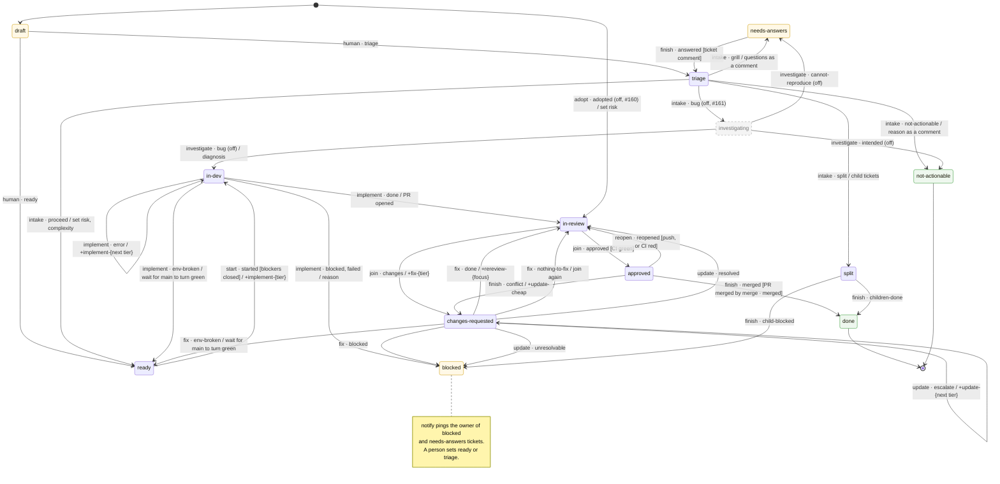
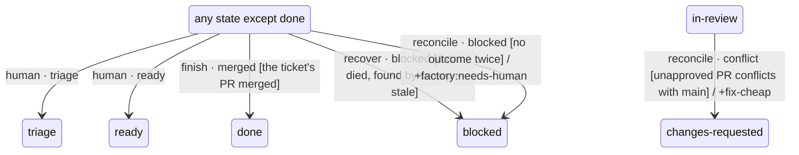
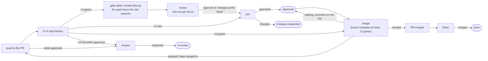
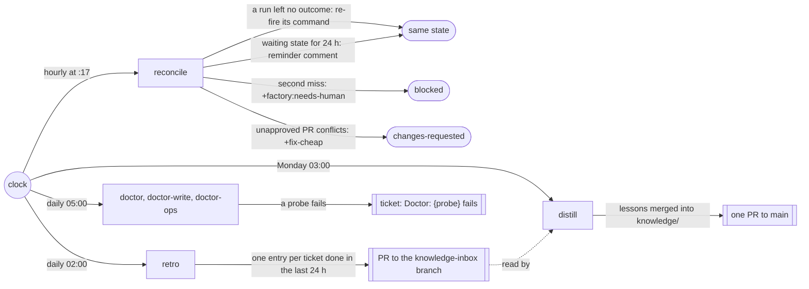

# Workflow: delivery

The per-ticket loop. `workflows/delivery.yaml` (format 2,
[ADR-0016](https://github.com/zaharchenko-evgeny/slop-factory/blob/main/docs/adr/0016-project-descriptor-and-workflow.md))
defines it as a list of nodes. Each node is a `[factory:<node>]` Air automation. A state, a command, a PR
event or a schedule wakes it. The node runs `factory check`, does its role's work, writes its handoff and runs
`factory apply`. The gate moves the state. The project descriptor (`factory.project.yaml`) names the
repositories, the states and commands with their labels, the models and the checks. The tracker operations are
in the engine's `docs/agents/issue-tracker.md`.

By hand, use the `factory-delivery` skill. It runs one node the same way.

## The ticket's states

Each box is a state, stored as the ticket label `factory:<state>`. Each arrow is one node's outcome, written
as `node · outcome`. Text in `[ ]` is a condition. Text after `/` is what the outcome adds: a command label
that wakes the next node, a comment or a field. A command such as `+implement-{tier}` is the label
`factory:implement-cheap`, `-mid` or `-strong`. Yellow states wait for a person. Dashed states and
arrows marked `off` are disabled in `delivery.yaml`, with their ticket.

A person, the `recover` sweep, the hourly `reconcile` and a merged PR can move a ticket from almost any
state. These arrows would cross the chart above, so this chart draws them from one pseudo-state.

`human` cannot move a `done` ticket. `finish · merged` does not apply to `not-actionable`. `recover` acts
only on `triage`, `ready`, `in-dev`, `in-review`, `changes-requested` and `approved`. `reconcile` acts on
these states and `split`.

## Inside in-review and approved

The PR, not the ticket, carries the CI result (`ci-green`, `ci-red`) and the merge (`pr-merged`). These PR
facts wake the nodes that move the ticket.

`merge` merges only while `gates.auto_merge.enabled` is true and the ticket's risk is at most
`gates.auto_merge.max_risk`. Otherwise it reports `waiting` with a comment, and a person merges the PR.
`finish` then moves the ticket to `done`.

## Scheduled nodes

Five nodes run on a clock, outside any ticket. Only `reconcile` changes a ticket's state. It does so in
`factory/reconcile.py`, so its outcome in `delivery.yaml` (`reconciled`) declares no state.

| Node | Schedule | Environment | What it does |
|---|---|---|---|
| `reconcile` | `17 * * * *`, hourly | ops | For a ticket in an active state with no outcome after `limits.run_timeout_minutes`, it re-fires the command that wakes the expected node. On a second miss it sets `blocked` and `factory:needs-human`. An unapproved PR that conflicts with main gets `fix-cheap` and `changes-requested`. A waiting ticket with an assignee gets a reminder comment after 24 hours. |
| `retro` | `0 2 * * *`, daily | ops | For each ticket that reached `done` since the last run, it writes one lesson entry to `knowledge.branch` (`knowledge-inbox`) and updates the one open inbox PR. |
| `distill` | `0 3 * * 1`, Mondays | ops | It merges the inbox entries into `knowledge/<repo>/lessons.md` and opens one PR to the default branch. |
| `doctor` | `0 5 * * *`, daily | read | It probes every write, read and tool the gate needs in its environment. A failed probe opens or updates the ticket `Doctor: <probe> fails`. |
| `doctor-write` | `0 5 * * *`, daily | write | The same probes in the `write` environment. |
| `doctor-ops` | `0 5 * * *`, daily | ops | The same probes in the `ops` environment. |

`recover` is a routine too, but a person starts it. It runs `factory sweep --stale` and moves a ticket whose
run died to `blocked`.

## What wakes each node

| Node | Wakes on | Runs when | Role · tier | Environment |
|---|---|---|---|---|
| `human` | a person | actor human | human |  |
| `intake` | state `triage` entered | state triage | router · cheap | read |
| `start` | state `ready` entered | state ready, blockers closed | script | read |
| `investigate` (off, #161) | state `investigating` entered | state investigating | developer · mid | write |
| `implement` | command `implement-<tier>` | state in-dev | developer · cheap/mid/strong | write |
| `adopt` (off, #160) | command `adopt` | state none | router · cheap | read |
| `review` | command `review-<focus>` command `rereview-<focus>` | state in-review, focus required-by-risk, ci green | reviewer · per focus | read |
| `join` | PR review submitted state `ci-red` entered | state in-review, ci green/red | script | read |
| `fix` | command `fix-<tier>` | state changes-requested, round complete, fix-rounds below-cap | developer · cheap/mid/strong | write |
| `update` | command `update-<tier>` | state changes-requested | developer · cheap/mid/strong | write |
| `reopen` | push to the PR state `ci-red` entered | state approved | script | read |
| `merge` | state `approved` entered state `ci-green` entered | state approved, round complete-at-head, ci green | script | read |
| `finish` | state `pr-merged` entered ticket closed state `blocked` entered ticket comment | always | script | read |
| `notify` | state `blocked` entered state `needs-answers` entered | state blocked/needs-answers | script | ops |
| `recover` (manual) | a person | always | script | read |
| `reconcile` | cron `17 * * * *` | always | script | ops |
| `doctor` | cron `0 5 * * *` | always | script | read |
| `doctor-write` | cron `0 5 * * *` | always | script | write |
| `doctor-ops` | cron `0 5 * * *` | always | script | ops |
| `retro` | cron `0 2 * * *` | always | retro · cheap | ops |
| `distill` | cron `0 3 * * 1` | always | distill · mid | ops |

## Input

A tracker ticket in state `triage` or `ready`.

## Handoffs

Each agent step ends with the structured block its role file defines. Steps
pass these blocks, never transcripts. The reviewer always starts fresh.

## External writes

Every push, label change, PR and comment carries the `[factory]` marker and a
`Factory-Run:` trailer. While `gates.confirm_external_writes` is `true`, each
write kind in `gates.confirm_external_writes_scope` is shown and waits for the
user's approval; a declined write stops the run with stage unchanged. Other
writes, including the push of the ticket's own branch, are auto-approved.
The `merge` node merges under `gates.auto_merge`, as described above.
